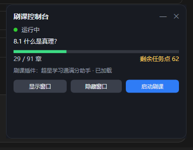

# 学习通页面增强


一个独立的学习通（超星）课程页增强工具，包含两部分：

- **浏览器端**：Tampermonkey 用户脚本，在课程页显示章节完成情况，一键跳到下一个未完成章节。
- **Windows 端（可选）**：刷课控制台，把专用浏览器放到屏幕外后台运行，桌面只留一个小窗显示状态、进度和插件。

> **本仓库不包含任何第三方刷课脚本的代码。** 自动播放、自动答题、自动提交等功能请自行安装你信任的脚本（例如 GreasyFork 上的 [超星学习通满分助手](https://greasyfork.org/scripts/436994)，作者 shushoujiu）。本项目只负责统计、跳转和控制台展示。

## 功能

### 用户脚本

- **章节统计**：已完成章节 / 总章节、未完成章节数、剩余任务点，带进度条。
- **一键继续**：跳到侧边栏第一个未完成章节，交给已安装的刷课脚本继续处理。
- **悬浮面板**：可拖动、可折叠，位置自动记住；只在课程页出现。
- **纯本地读取**：只读页面 DOM，不发网络请求，不上传数据。

### 刷课控制台（Windows，可选）

- 专用 Edge 放到**屏幕外**运行，桌面留给其他工作，视频播放不受影响。
- 小窗口实时显示：
  - 状态：答题中 / 运行中 / 等待手动提交 / 需要登录
  - 当前章节
  - 已完成章节 / 总章节 + 进度条
  - 剩余任务点
  - 刷课插件是否已加载
- 一键**显示窗口 / 隐藏窗口 / 启动刷课**；右上角 `—` 最小化到任务栏，`✕` 只关控制台（后台刷课不受影响）。

## 截图



## 安装用户脚本

1. 在 Edge 扩展商店安装 **篡改猴 / Tampermonkey**。
2. 打开 `edge://extensions` → 篡改猴 → **详细信息** → 打开 **允许用户脚本** → 回到扩展页点 **重新加载**。
   > 不做这一步，脚本会静默不运行，是最常见的坑。
3. 下载本脚本：在本仓库打开 `chaoxing-helper.user.js` → 点右上角 **Raw**，篡改猴会自动弹出安装页。
4. 打开任意学习通课程页，左上角出现「学习通页面增强」面板即安装成功。

## 使用

- 面板自动统计当前课程。
- **继续刷课**：跳到第一个未完成章节。
- **刷新**：手动重算（正常情况下每 3 秒自动刷新）。
- 拖动标题栏移动面板，点右侧 `—` 折叠。

## 可选：Windows 刷课控制台

`windows/` 目录提供一套 Windows 辅助脚本。不使用也不影响用户脚本本身。

| 文件 | 作用 |
|---|---|
| `console.ps1` | 刷课控制台：小窗口显示状态/进度/插件 |
| `launch.ps1` | 用独立配置启动 Edge（调试端口 9222），支持 `-Hidden` 屏幕外运行 |
| `start-brush.ps1` | 浏览器没开就后台启动并打开课程页；已开则聚焦或隐藏 |
| `create-shortcut.ps1` | 在桌面生成 `刷课控制台.lnk` 和 `刷课控制台.bat` |
| `show-window.ps1` / `restore-window.ps1` | 显示 / 找回浏览器窗口 |
| `启动浏览器.bat` | 双击运行 `launch.ps1` |

### 首次配置

在 `windows/` 目录下新建两个文本文件（已被 `.gitignore` 排除，不会提交）：

- `profile_dir.txt`：Edge 配置目录路径。不创建则默认使用 `%LOCALAPPDATA%\ChaoxingStudyEdge`。
- `course_url.txt`：后台刷课要打开的课程页完整地址。

然后运行 `create-shortcut.ps1`，桌面会出现 `刷课控制台.lnk`（和备用 `.bat`）。

### 控制台说明

- 打开控制台时，如果浏览器没启动，会自动在后台启动并打开课程页。
- 如果登录已过期，控制台会自动把浏览器窗口调出来，扫码登录后继续。
- **显示窗口** / **隐藏窗口** 可以在主屏和屏幕外之间切换。
- 右上角 **—** 可以把控制台最小化到任务栏，点任务栏图标恢复；**✕** 只关闭控制台，后台刷课继续。
- 控制台通过本地调试端口 `9222` 读取页面状态，只读不写。

### 常见问题

- **控制台显示“浏览器未启动”**：点「启动刷课」；若仍失败，检查 9222 端口是否被占用。
- **课程页提示 enc 失效或跳登录**：把浏览器里当前课程页的完整地址复制到 `course_url.txt`。
- **快捷方式被安全软件删除**：直接双击 `刷课控制台.bat`。快捷方式走 `cmd → bat → PowerShell`，就是为了避开这类误杀。

## 工作原理

- 用户脚本读取课程页侧边栏的 `.posCatalog_select` / `.prevHoverTips`，统计章节状态；跳转调用页面原有的 `getTeacherAjax`。
- 控制台通过 Chrome DevTools Protocol（`/json/list` + `Runtime.evaluate`）读取同一份 DOM 数据，不注入、不修改页面。

## 兼容性与限制

- 依赖学习通旧版课程页的 DOM 结构，平台改版后可能失效。
- 仅在 Windows + Edge + 篡改猴 5.x 上测试过（2026-10）。
- 不处理答题、不修改课程数据、不自动提交任何内容。
- 控制台为 Windows 专用（WPF + PowerShell），其他系统只能使用用户脚本部分。

## 隐私

- 只读取当前页面上的章节标题和状态。
- 用户脚本不发起网络请求；控制台只连接本机 `127.0.0.1:9222`。
- 不收集、不上报任何信息。

## 免责声明

本项目仅供个人学习与技术交流。使用自动化工具可能违反平台的服务条款，由此产生的后果由使用者自行承担。本项目与超星学习通及上述第三方脚本作者无关。

## 许可证

[MIT](LICENSE)

## 致谢

- 刷课脚本：[shushoujiu / 超星学习通满分助手](https://greasyfork.org/scripts/436994)（不在本仓库内）
- 面板样式参考了常见的深色悬浮组件设计

## 仓库结构

```
chaoxing-enhancer/
├─ chaoxing-helper.user.js   # 用户脚本（MIT）
├─ windows/                  # 可选的 Windows 控制台与启动器
├─ docs/console.png          # 控制台截图
├─ LICENSE
├─ README.md
└─ .gitignore
```
